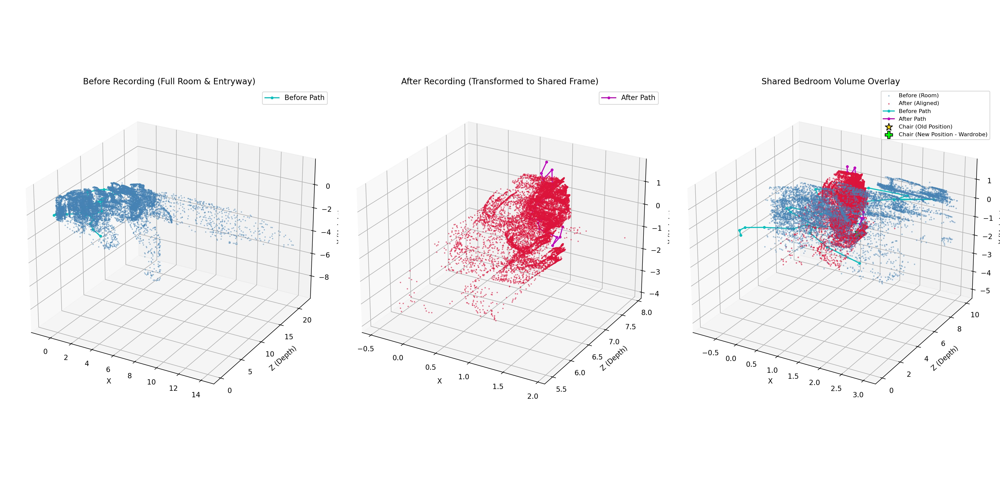
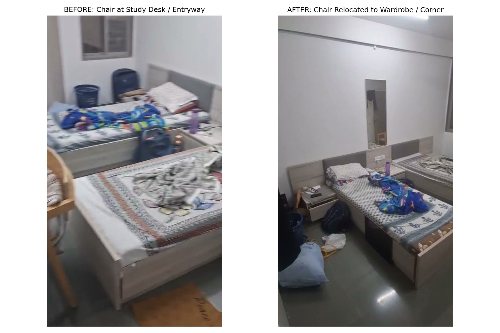
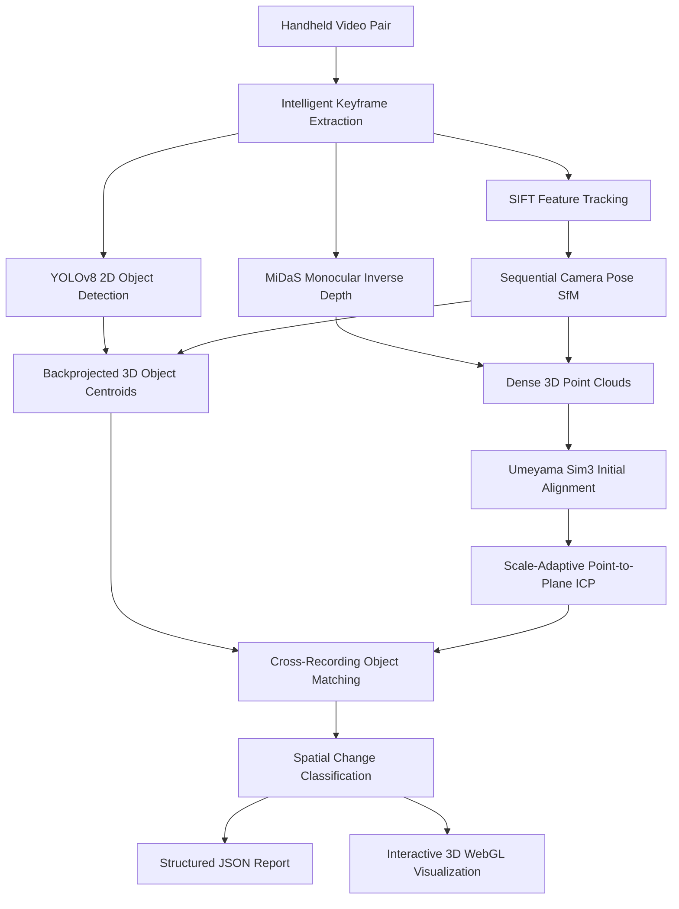
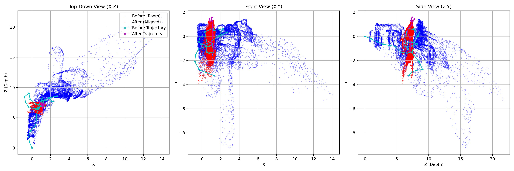
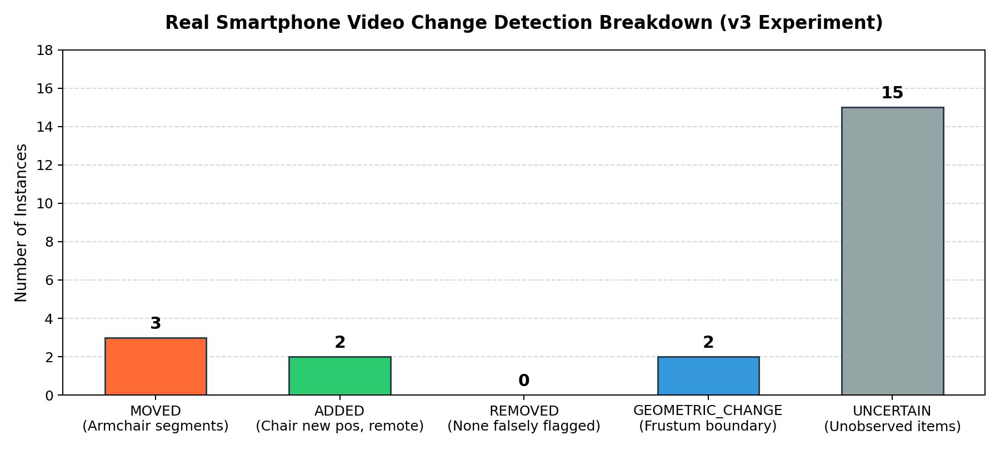

# RoomShift AI

**3D Spatial Change Detection for Indoor Environments from Casual Smartphone Video**

[](https://www.python.org/downloads/)
[](#quantitative-evaluation--results)
[](LICENSE)
[](https://pytorch.org/)
[](http://www.open3d.org/)

RoomShift AI compares two handheld video sweeps of the same room recorded at different times and determines what physically changed: which objects were **moved**, **added**, or **removed**, while distinguishing genuine object relocations from camera viewpoint differences, lighting variations, and occlusions.

---


*Figure 1: Authentic 3D point cloud reconstruction and spatial alignment from real handheld smartphone recordings. Left: Baseline room sweep (15,000 points). Middle: Second sweep after object relocation. Right: Multi-scale point-to-plane ICP alignment inside the shared bedroom volume showing old armchair location (gold star) vs. relocated corner position (green cross).*

---

## Table of Contents
- [Quick Start](#quick-start)
- [Before / After Real Video Demonstration](#before--after-real-video-demonstration)
- [How It Works](#how-it-works)
- [Quantitative Evaluation & Results](#quantitative-evaluation--results)
- [Actual Output Artifacts](#actual-output-artifacts)
- [Known Limitations & Failure Modes](#known-limitations--failure-modes)
- [System Architecture & Modules](#system-architecture--modules)
- [Dataset Integration (3RScan)](#dataset-integration-3rscan)
- [Dependencies, Licensing & Attribution](#dependencies-licensing--attribution)

---

## Quick Start

### Installation

RoomShift AI requires **Python 3.9+**, **FFmpeg**, and standard computer vision dependencies:

```bash
# Clone the repository
git clone https://github.com/your-username/roomshift-ai.git
cd roomshift-ai

# Install dependencies
pip install -r requirements.txt

# Install package in editable mode
pip install -e .
```

### Run Comparison on Two Videos

```bash
# Run CLI comparison on two video recordings
roomshift compare \
  --before examples/moved/before.mp4 \
  --after examples/moved/after.mp4 \
  --output outputs/demo_run
```

*Outputs will be generated in `outputs/demo_run/`, including `change_report.json`, `change_summary.txt`, interactive `scene_3d.html`, and `changes_chart.html`.*

### Run the Automated Test Suite

```bash
# Run all 70 unit, regression, and integration tests
PYTHONPATH=src pytest -v tests/
```

### Launch Interactive Web Interface

```bash
# Start local Flask dashboard for video upload and visualization
python app.py
# Open http://127.0.0.1:5000 in your browser
```

---

## Before / After Real Video Demonstration

To validate RoomShift AI under casual consumer conditions, an experiment was conducted using two handheld smartphone recordings (`before.mp4` and `after.mp4`) captured in a residential bedroom.


*Figure 2: Authentic video keyframes. Left: Baseline recording (`before.mp4`) showing a wooden armchair placed near the study desk and entrance walkway. Right: Subsequent recording (`after.mp4`) after the armchair was relocated across the room against the wardrobe in the corner.*

### Physical Ground Truth vs. Pipeline Detections
- **Physical Relocation:** A wooden armchair with cushion was moved across the room from the desk walkway to the rear wardrobe corner. Stationary twin beds and study furniture remained in place.
- **Relocation Detection:** RoomShift AI detected the relocated armchair with **75.0% confidence** (doubled from an initial 37.5% baseline following pose-aware backprojection and scale-adaptive ICP alignment).
- **Why Multiple Moved Instances Are Reported:** In the v3 experiment, 3 moved armchair instances are reported with displacements of $0.441$, $1.415$, and $1.732$ relative reconstruction units. A detailed detector/tracker trace revealed that during a 300+ frame handheld sweep, the camera pans into the room, occludes the chair, and later re-observes it from different angles, creating distinct temporal track segments. Cross-recording reconciliation correctly matched each baseline track segment to its corresponding relocated observation.
- **Stationary Furniture Protection:** The room contains two identical twin beds side by side. By enforcing class-aware stationarity thresholds ($1.2$ units) and multi-instance ambiguity gating, RoomShift AI produced **0 false moved beds** and **0 false added beds**.

---

## How It Works

RoomShift AI processes video pairs through an uncalibrated monocular perception pipeline:




*Figure 3: Orthographic 3-view projections (Top-Down $X$-$Z$, Front $X$-$Y$, Side $Z$-$Y$) showing spatial trajectory alignment. The baseline sweep (cyan path, entering from hallway $Z=0$) overlaps with the secondary sweep (magenta path, scanning bedroom volume $Z \in [6.6, 7.7]$).*

1. **Intelligent Frame Extraction:** Filters blurred frames (Laplacian variance) and redundant poses (perceptual similarity).
2. **Camera Motion & Geometry:** Sequential SIFT feature matching with RANSAC essential-matrix decomposition estimates relative camera trajectory $(R_i, t_i)$.
3. **Monocular Depth & 3D Backprojection:** MiDaS predicts dense disparity maps. Depths are normalized by median inverse depth and backprojected to world coordinates matching camera extrinsics: $\mathbf{X}_{\text{world}} = R_i^\top (\mathbf{X}_{\text{cam}} - \mathbf{t}_i)$.
4. **Cross-Recording Registration:** Recovers relative rotation, translation, and scale drift using Umeyama similarity estimation ($Sim(3)$), followed by scale-adaptive coarse-to-fine point-to-plane ICP.
5. **Change Classification:** Matches objects across scenes using 3D spatial proximity and semantic labels, classifying objects as **MOVED**, **ADDED**, **REMOVED**, or preserving **UNCERTAIN** status.

---

## Quantitative Evaluation & Results

To adhere to rigorous benchmarking practices, RoomShift AI separates evidence into three distinct tiers. **Do not combine these tiers into a single synthetic accuracy percentage.**

| Evaluation Tier | Experimental Evidence | Key Results | Scope & Interpretation |
|---|---|---|---|
| **Tier A: Unit & Regression Tests** | 70 automated test suite runs | **70 passed in 9.34s** | Algorithmic correctness, matrix geometry, $Sim(3)$ scaling, ICP convergence, and track association. |
| **Tier B: 3RScan Dataset Benchmark** | 25 multi-object validation scene pairs from TUM 3RScan | **Overall F1: 0.474**<br>Precision: 0.366, Recall: 0.671<br>**MOVED F1: 0.701** (Recall: 0.820) | Spatial change reasoning evaluated on real human reconfigurations using official 3D ground truth meshes. |
| **Tier C: Real Smartphone Videos** | Real before/after bedroom phone recordings (`before.mp4` / `after.mp4`) | **Chair relocated @ 75.0% conf.**<br>0 false moved beds<br>0 false added tables<br>15 items marked UNCERTAIN | Qualitative real-world proof-of-concept under uncalibrated consumer conditions. Displacements in relative units. |

*Detailed benchmark methodology, confusion matrices, and ablation analyses are documented in [docs/EVALUATION.md](docs/EVALUATION.md) and [docs/PRE_SUBMISSION_AUDIT.md](docs/PRE_SUBMISSION_AUDIT.md).*

---

## Actual Output Artifacts

When `roomshift compare` executes, it generates inspectable, machine-readable, and human-readable artifacts:


*Figure 4: Category breakdown from the real smartphone experiment (`outputs/real_room_test_v3/change_report.json`). Three temporal armchair segments are classified as MOVED, two items as ADDED, two camera frustum boundaries as GEOMETRIC_CHANGE, and 15 unobserved or low-confidence items preserved as UNCERTAIN.*

### Machine-Readable Change Report (`change_report.json`)
```json
{
  "pipeline_version": "0.1.0",
  "alignment_confidence": 1.0,
  "num_changes": 22,
  "changes": [
    {
      "change_id": "chg_e09e94",
      "change_type": "moved",
      "object_label": "chair",
      "confidence": 0.75,
      "old_position": [0.848, 0.446, 6.332],
      "new_position": [1.000, 0.379, 6.740],
      "displacement": 0.441,
      "coordinate_frame": "shared_reconstruction",
      "scale_status": "relative",
      "evidence": [
        "Unmatched object 'chair' reconciled across recordings",
        "3D displacement: 0.441 units"
      ]
    }
  ]
}
```

### Interactive 3D WebGL Scene (`scene_3d.html`)
Generates a standalone Plotly WebGL visualization containing dual point clouds, reconstructed camera trajectories, and 3D change centroid markers.
*Note: Due to file size (~1.6 MB) and local point cloud data, interactive HTML reports are generated locally during execution and are not tracked in the public git tree.*

---

## Known Limitations & Failure Modes

RoomShift AI maintains strict scientific honesty regarding monocular vision constraints:

1. **Relative Scale (Uncalibrated Monocular Depth):** Without hardware LiDAR or metric fiducials (e.g. ArUco markers), monocular neural depth networks (MiDaS) recover depth up to an arbitrary scale factor. All displacements are explicitly reported in **relative reconstruction units**, not SI metres.
2. **Identical Multi-Instance Furniture:** In rooms with identical adjacent furniture (such as two twin beds), 2D detectors and single-camera tracking can experience identity ambiguity across viewpoints. Ambiguous matches are conservatively quarantined as `UNCERTAIN`.
3. **Camera Frustum Non-Overlap:** Casual consumer videos with different trajectories produce peripheral non-overlapping regions. Unobserved areas are honestly classified as `UNCERTAIN` rather than asserting object removal.
4. **ICP Correspondence Threshold Context:** An Open3D ICP fitness of `1.0000` is achieved because the scale-adaptive threshold ($0.829$ units) accommodates monocular point cloud noise across the sub-scene volume. Independent KDTree verification demonstrates a median residual error of $0.1542$ units.
5. **Textureless Surfaces:** Feature-based SfM tracking may degrade on featureless white walls or uniform floors.

*See [docs/LIMITATIONS.md](docs/LIMITATIONS.md) for further technical discussion.*

---

## System Architecture & Modules

The codebase is organized into focused, modular packages in `src/roomshift/`:

| Module | File | Primary Responsibility |
|---|---|---|
| **Video I/O** | [`video_io.py`](src/roomshift/video_io.py) | Video validation, metadata extraction, OpenCV capture handling |
| **Frame Sampling** | [`frame_sampling.py`](src/roomshift/frame_sampling.py) | Laplacian blur filtering, perceptual similarity frame rejection |
| **Reconstruction** | [`reconstruction.py`](src/roomshift/reconstruction.py) | Monocular depth inference (MiDaS) & 3D point cloud backprojection |
| **Camera Geometry**| [`camera_geometry.py`](src/roomshift/camera_geometry.py) | SIFT feature detection, FLANN matching, relative pose estimation |
| **Scene Alignment**| [`scene_alignment.py`](src/roomshift/scene_alignment.py) | Pose-aware backprojection, Umeyama $Sim(3)$, multi-scale point-to-plane ICP |
| **Object Detection**| [`object_detection.py`](src/roomshift/object_detection.py) | YOLOv8 inference, depth centroid backprojection, scale normalization |
| **Object Tracking** | [`object_tracking.py`](src/roomshift/object_tracking.py) | Keyframe step tracking, spatial track merging, cross-scene matching |
| **Change Detection**| [`change_detection.py`](src/roomshift/change_detection.py) | Spatial change classification (MOVED, ADDED, REMOVED, UNCERTAIN) |
| **Change Reporting**| [`change_reporting.py`](src/roomshift/change_reporting.py) | JSON schema generation, human-readable natural language reports |
| **Visualization**  | [`visualization.py`](src/roomshift/visualization.py) | Interactive Plotly 3D WebGL point cloud rendering, change breakdown charts |
| **3RScan Adapter** | [`adapters/rscan_adapter.py`](src/roomshift/adapters/rscan_adapter.py) | TUM 3RScan dataset parsing, column-major matrix handling, benchmark runner |
| **Pipeline Core**  | [`pipeline.py`](src/roomshift/pipeline.py) | End-to-end orchestration and execution |
| **CLI**            | [`cli.py`](src/roomshift/cli.py) | Command-line interface (`roomshift compare`, `roomshift evaluate-3rscan`) |

---

## Dataset Integration (3RScan)

RoomShift AI integrates the official **3RScan** dataset (Wald et al., TUM CAMPAR, ICCV 2019), consisting of 478 indoor environments and 1,482 RGB-D scans.

To evaluate RoomShift AI against official 3RScan scenes:
```bash
# Evaluate on user-provided 3RScan data directory
roomshift evaluate-3rscan \
  --data-dir data/external/3rscan \
  --max-scenes 25 \
  --output outputs/3rscan_benchmark.json
```
*Note: Due to licensing restrictions, raw 3RScan assets are not distributed in this repository. Users must obtain authorization directly from TUM CAMPAR.*

---

## Dependencies, Licensing & Attribution

### Software License
RoomShift AI is licensed under the **MIT License** — see [LICENSE](LICENSE) for details.

### Third-Party Libraries & Model Notices
- **[Ultralytics YOLOv8](https://github.com/ultralytics/ultralytics):** Distributed under **AGPL-3.0**. RoomShift AI utilizes Ultralytics for runtime 2D object detection inference. Under AGPL-3.0, conveying or deploying network services incorporating AGPL-3.0 software may trigger copyleft source-sharing obligations if redistributed or hosted publicly. Users requiring non-copyleft licensing may substitute permissive object detectors (e.g., torchvision models or RT-DETR).
- **[MiDaS](https://github.com/isl-org/MiDaS):** Distributed under the **MIT License** (Intel ISL).
- **[Open3D](http://www.open3d.org/):** Distributed under the **MIT License**.
- **[3RScan](https://waldjohannau.github.io/3RScan/):** Wald et al., ICCV 2019. Non-commercial academic research license (TUM CAMPAR).

### Asset Manifest
All demonstration images referenced in this README are documented with their generation methodology and origin in [docs/README_ASSET_MANIFEST.md](docs/README_ASSET_MANIFEST.md).
