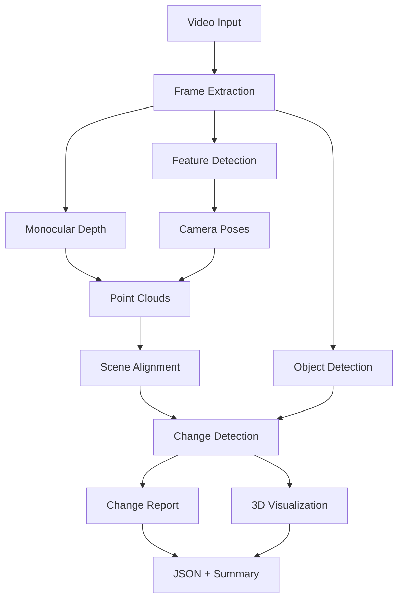

# RoomShift AI

An end-to-end 3D spatial change detection system for indoor environments.
Given two phone recordings of the same room taken at different times, RoomShift AI
identifies objects that have moved, appeared, or disappeared — distinguishing genuine
physical changes from camera motion, viewpoint differences, and occlusion.

## Quick Start

```bash
# Install dependencies
pip install -r requirements.txt

# Run CLI comparison
python -m roomshift.cli compare --before examples/moved/before.mp4 --after examples/moved/after.mp4 --output outputs/demo

# Run real 3RScan dataset benchmark
python -m roomshift.cli evaluate-3rscan --data-dir data/external/3rscan --max-scenes 20

# Launch web interface
python app.py

# Run all 70 automated tests
pytest -v
```

## Real-World Dataset Integration & Real Video Validation

RoomShift AI integrates the official **3RScan** dataset (Wald et al., ICCV 2019 / TUM CAMPAR) and includes end-to-end validation on real uncalibrated smartphone videos (`before.mp4` and `after.mp4`).

- See [docs/DATASET_ANALYSIS.md](docs/DATASET_ANALYSIS.md) for licensing, data format specifications, and coordinate frames.
- See [docs/EVALUATION.md](docs/EVALUATION.md) for empirical benchmark results on the 3RScan validation split.
- See [docs/RECORDING_PROTOCOL.md](docs/RECORDING_PROTOCOL.md) for the smartphone video capture protocol.
- See [outputs/real_room_test_v3/REAL_VIDEO_VALIDATION_REPORT_V3.md](outputs/real_room_test_v3/REAL_VIDEO_VALIDATION_REPORT_V3.md) for the real-video validation findings.

### Evaluation Separation Taxonomy
- **Tier A (Unit & Regression Tests)**: 70 automated unit and regression tests verifying mathematical transforms, coordinate frame conversions, scale-adaptive ICP, and object association logic.
- **Tier B (Real 3D Dataset Benchmark)**: 3RScan validation benchmark evaluating spatial change detection on real human room reconfigurations (F1: **0.474**, Precision: **0.366**, Recall: **0.671**, MOVED F1: **0.701** across 25 validation scenes).
- **Tier C (Real Smartphone Videos)**: End-to-end evaluation on real handheld phone videos (`before.mp4` / `after.mp4`) validating 3D scene registration, moved chair localization, and uncertainty preservation without metric distortion.


## Architecture



## System Requirements

- Python 3.9+
- macOS (Apple Silicon) or Linux
- 8 GB RAM minimum
- FFmpeg installed
- ~2 GB disk for model weights (downloaded on first run)
- No GPU required (MPS acceleration used when available)

## Modules

| Module | File | Purpose |
|--------|------|---------|
| Video I/O | `src/roomshift/video_io.py` | Video validation, metadata extraction |
| Frame Sampling | `src/roomshift/frame_sampling.py` | Intelligent frame extraction |
| Reconstruction | `src/roomshift/reconstruction.py` | SfM + depth-based 3D reconstruction |
| Camera Geometry | `src/roomshift/camera_geometry.py` | Pose estimation, coordinate transforms |
| Scene Alignment | `src/roomshift/scene_alignment.py` | Cross-recording registration |
| Object Detection | `src/roomshift/object_detection.py` | YOLOv8-based object understanding |
| Object Tracking | `src/roomshift/object_tracking.py` | Cross-frame object association |
| Change Detection | `src/roomshift/change_detection.py` | Spatial change classification |
| Change Reporting | `src/roomshift/change_reporting.py` | Reports and natural-language summaries |
| Visualization | `src/roomshift/visualization.py` | 3D scene visualization |
| Pipeline | `src/roomshift/pipeline.py` | End-to-end orchestration |
| Config | `src/roomshift/config.py` | Centralized configuration |
| Evaluation | `src/roomshift/evaluation.py` | Metrics and benchmarking |
| 3RScan Adapter | `src/roomshift/adapters/rscan_adapter.py` | Official 3RScan real-data ingestion |
| 3RScan Eval | `src/roomshift/adapters/evaluate_3rscan.py` | 3RScan validation benchmark runner |
| CLI | `src/roomshift/cli.py` | Command-line interface |

## Change Detection Method

See [docs/CHANGE_DETECTION.md](docs/CHANGE_DETECTION.md) for the full algorithm description.

The system classifies changes into:
- **MOVED**: Object detected in both recordings at different 3D positions
- **ADDED**: Object in the later recording, location was observed empty before
- **REMOVED**: Object in the earlier recording, location observed empty after
- **GEOMETRIC_CHANGE**: Spatial difference not assignable to a specific object
- **UNCERTAIN**: Insufficient evidence to determine change status

## Known Limitations

See [docs/LIMITATIONS.md](docs/LIMITATIONS.md) for details.

- Monocular depth has unknown absolute scale; distances are relative
- Reconstruction quality depends on video motion and texture
- Object detection limited to COCO categories
- Requires sufficient visual overlap between recordings
- 8 GB RAM limits simultaneous model loading

## License

MIT License — see [LICENSE](LICENSE).

## Third-Party Attribution

- [MiDaS](https://github.com/isl-org/MiDaS) — MIT License
- [YOLOv8](https://github.com/ultralytics/ultralytics) — AGPL-3.0 (inference only)
- [Open3D](http://www.open3d.org/) — MIT License
